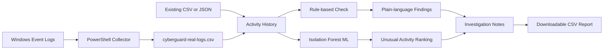

# CyberGuard AI

### Cybersecurity Log Anomaly Detection & Investigation Workbench

[](https://cyberguard-ai-team.streamlit.app/)
[](https://streamlit.io/)
[](https://www.python.org/)
[](https://scikit-learn.org/)

CyberGuard AI is an M.Tech cybersecurity analytics project that helps people collect or upload real Windows activity logs, identify suspicious sign-in patterns, find unusual events with machine learning, and understand the results in clear everyday language.

> **Live application:** [cyberguard-ai-team.streamlit.app](https://cyberguard-ai-team.streamlit.app/)
>
> **GitHub organization:** [CyberGuard-AI-Team](https://github.com/CyberGuard-AI-Team)
>
> **Source repository:** [CyberGuard-AI-Team/Cyberguard-AI](https://github.com/CyberGuard-AI-Team/Cyberguard-AI)

---

## Table of contents

- [What the project does](#what-the-project-does)
- [How CyberGuard works](#how-cyberguard-works)
- [Main features](#main-features)
- [Detection logic](#detection-logic)
- [Machine-learning model](#machine-learning-model)
- [Windows events collected](#windows-events-collected)
- [Using the hosted website](#using-the-hosted-website)
- [Running locally](#running-locally)
- [Supported log format](#supported-log-format)
- [Technology stack](#technology-stack)
- [Data handling and security](#data-handling-and-security)
- [Current limitations](#current-limitations)
- [Future roadmap](#future-roadmap)
- [Project team](#project-team)

---

## What the project does

Windows and application logs contain useful security evidence, but raw event records are difficult for non-technical users to understand. CyberGuard turns those records into a simple workflow:

1. **Collect or upload real logs.**
2. **Run transparent security checks.**
3. **Use machine learning to rank unusual activity.**
4. **Read findings in plain language.**
5. **Record follow-up notes and export a report.**

CyberGuard is designed as a security analysis and decision-support tool. It does **not** claim that every unusual event is an attack, and it is not a replacement for antivirus, EDR, a firewall, or an enterprise SIEM.

## How CyberGuard works



The hosted Streamlit application cannot directly inspect a visitor's computer. Instead, it provides a downloadable Windows collector that runs on the user's PC and creates a CSV file on the Desktop. The user then uploads that file to CyberGuard for analysis.

## Main features

| Section | Purpose |
|---|---|
| **Home** | Shows the recommended starting point, recent activity, active findings, and next steps. |
| **My profile** | Manages the user's display name, profile information, password, recent records, and recent checks. |
| **Check my activity** | Runs quick or detailed rule-based checks against the logs currently loaded in the workspace. |
| **Activity history** | Uploads, searches, filters, inspects, and downloads CSV/JSON security events. |
| **What needs attention** | Converts technical rule matches into simple explanations and recommended actions. |
| **My follow-ups** | Tracks case status, assignment, investigation notes, and downloadable case reports. |
| **Activity summary** | Displays severity, event type, account, source, and time-based activity patterns. |
| **Smart analysis** | Uses Isolation Forest to rank records that differ from the current activity baseline. |
| **Ask CyberGuard** | Answers supported questions using evidence already present in the workspace. |
| **Connect my PC** | Downloads the Windows collector or reads selected Windows events directly when run locally. |
| **About CyberGuard** | Explains the workflow, every feature, data handling, and result interpretation. |

The interface includes back navigation, page-specific help panels, scan progress animations, green/red check results, Indian Standard Time display, and plain-language security guidance.

## Detection logic

The guided security check uses an explainable sign-in rule:

```text
Five or more failed sign-ins from the same source within 15 minutes
                         ↓
Check the following hour for a successful sign-in or privilege change
                         ↓
Create a finding, link the evidence, and recommend the next action
```

The rule helps identify password guessing or brute-force-like behaviour. A match is a reason to investigate, not proof that an account or device was compromised.

Typical recommendations include changing the password, signing out other sessions, enabling multi-factor authentication, and asking IT support to review the linked events.

## Machine-learning model

CyberGuard's **Smart analysis** page uses an unsupervised [Isolation Forest](https://scikit-learn.org/stable/modules/generated/sklearn.ensemble.IsolationForest.html) model.

### Model configuration

- **Algorithm:** Isolation Forest
- **Trees:** 200
- **Random seed:** 42 for repeatable project demonstrations
- **Minimum records in the UI:** 8
- **Sensitivity / contamination:** 5%, 10%, or 20%

### Features used

- Hour of the event
- Severity weight
- Frequency of the event type
- Frequency of the account
- Frequency of the source address
- One-hot encoded event type
- One-hot encoded account
- One-hot encoded source IP
- One-hot encoded event status

Isolation Forest was selected because security datasets often do not have reliable attack labels. It can learn a baseline from the currently loaded records and identify rare combinations without requiring a pre-labelled training dataset.

The displayed anomaly score is a **relative ranking within the current uploaded dataset**. It is not a probability of hacking or compromise, and every result must be reviewed with its evidence.

## Windows events collected

The one-time collector reads selected recent events from the Windows **Security**, **System**, and **Application** channels.

| Event ID | CyberGuard label | Meaning |
|---:|---|---|
| 4624 | Successful Login | A Windows logon completed successfully. |
| 4625 | Failed Login | A Windows logon attempt failed. |
| 4672 | Privilege Change | Special privileges were assigned to a new logon. |
| 4688 | Process Start | A new process was created, when process auditing is enabled. |
| 4697 | Service Installation | A service was installed on the system. |

The collector also reads accessible System and Application warnings/errors. Security-log access can require Administrator permission, and unavailable auditing settings may mean that some event types are not present.

## Using the hosted website

Open the [live CyberGuard AI application](https://cyberguard-ai-team.streamlit.app/) and follow these steps:

1. Create a CyberGuard account or sign in.
2. Open **Connect my PC**.
3. Download `cyberguard-log-collector.cmd`.
4. Open the Windows **Downloads** folder and double-click the downloaded file.
5. Approve the Administrator prompt.
6. Wait for the green success message.
7. Find `cyberguard-real-logs.csv` on the Desktop.
8. Return to CyberGuard and open **Activity history**.
9. Upload the CSV and select **Import records**.
10. Open **Check my activity** or **Smart analysis**.

The collector pauses before closing and displays either the saved CSV location or a readable error message.

## Running locally

### Requirements

- Python 3.10 or newer
- Windows 10/11 for direct Windows Event Log collection
- Administrator PowerShell for complete Security-log access

### Installation

```bash
git clone https://github.com/CyberGuard-AI-Team/Cyberguard-AI.git
cd Cyberguard-AI
python -m venv .venv
```

Activate the environment:

```powershell
# Windows PowerShell
.\.venv\Scripts\Activate.ps1
```

```bash
# Linux or macOS
source .venv/bin/activate
```

Install dependencies and start the application:

```bash
python -m pip install -r requirements.txt
python -m streamlit run streamlit_app.py --server.address 127.0.0.1
```

Then open [http://127.0.0.1:8501](http://127.0.0.1:8501).

For direct Windows collection, start PowerShell as Administrator before running Streamlit. Locally collected events remain in the active Streamlit session and are not automatically transmitted to a cloud service.

## Supported log format

CyberGuard accepts `.csv` and `.json` files. Each record should provide these fields:

| Required field | Accepted aliases/examples |
|---|---|
| `timestamp` | `time`, `created_at`; ISO 8601 recommended |
| `eventId` | `event_id`, `id` |
| `eventType` | `event_type`, `type` |
| `user` | `username`, `actor` |
| `sourceIp` | `source_ip`, `src_ip` |
| `severity` | Critical, High, Medium, Low, or Informational |
| `status` | `result` |
| `description` | `message` |
| `destinationIp` | Optional: `destination_ip`, `dst_ip` |

Example CSV:

```csv
timestamp,eventId,eventType,user,sourceIp,destinationIp,severity,status,description
2026-11-16T08:15:00Z,4625,Failed Login,DESKTOP\\vaibhav,192.0.2.10,,Medium,Failed,An account failed to log on
2026-11-16T08:20:00Z,4624,Successful Login,DESKTOP\\vaibhav,192.0.2.10,,Low,Success,An account was successfully logged on
```

Imported timestamps are normalized and displayed in Indian Standard Time (`IST`, UTC+05:30).

## Technology stack

| Technology | Use in the project |
|---|---|
| [Python](https://www.python.org/) | Application, detection, authentication, and data-processing logic |
| [Streamlit](https://streamlit.io/) | Interactive web interface and Community Cloud deployment |
| [pandas](https://pandas.pydata.org/) | CSV/JSON processing, filtering, tables, and analytics |
| [scikit-learn](https://scikit-learn.org/) | Isolation Forest anomaly detection |
| SQLite | Local account and investigation storage |
| PowerShell | Windows Event Log collection with `Get-WinEvent` |
| HTML/CSS/JavaScript | Styling, animations, and hosted browser-local investigation notes |
| [GitHub](https://github.com/CyberGuard-AI-Team/Cyberguard-AI) | Source control and team collaboration |
| [Streamlit Community Cloud](https://streamlit.io/cloud) | Public hosting |

Python dependencies are listed in [`requirements.txt`](requirements.txt). Additional Streamlit-specific notes are available in [`STREAMLIT.md`](STREAMLIT.md).

## Data handling and security

- The hosted application cannot silently read files or event logs from a visitor's computer.
- The downloadable collector runs only after the user starts it and approves Windows Administrator access.
- The collector creates a local CSV; it does not automatically upload logs.
- Imported events are stored in the current Streamlit session.
- Hosted investigation notes are stored in the browser's local storage and can be exported to CSV.
- Local Windows investigations can be stored in `cyberguard-local.db`.
- Account passwords are salted and hashed with PBKDF2-HMAC-SHA256 instead of being stored as plain text.
- Use a unique practice password for this educational project; do not reuse a work, email, or banking password.

## Current limitations

- The hosted Streamlit server cannot directly scan a visitor's computer.
- Collection is one-time, not continuous background monitoring.
- The current Streamlit app does not automatically connect to the repository's separate monitoring agent or Node/PostgreSQL API.
- Imported logs and scan results are session-scoped.
- Hosted account storage is not a production-grade durable identity service.
- The assistant is evidence- and keyword-based; it is not a general-purpose LLM chatbot.
- The anomaly model has not been presented as an independently evaluated production threat classifier.
- An unusual event is not automatically malicious.
- CyberGuard does not block IP addresses, terminate processes, quarantine files, or remediate devices.

## Future roadmap

### Platform and identity

- Durable PostgreSQL/Supabase storage
- Email verification and password recovery
- Organization workspaces and role-based access control
- Encrypted log storage and retention controls

### Collection and monitoring

- Secure installable Windows/Linux agent
- Continuous event streaming and scheduled scans
- Multiple-device inventory, health, and heartbeat status
- Central device enrollment and credential revocation

### Security detections

- Sigma rule support
- MITRE ATT&CK mapping
- Impossible-travel and unfamiliar-device detection
- Suspicious process and service-installation detection
- Threat-intelligence enrichment for IP addresses and domains

### Machine learning

- Per-user and per-device behavioural baselines
- Model evaluation with precision, recall, and F1-score
- Feedback-driven false-positive reduction
- Model versioning, drift monitoring, and explainable-AI reports
- Sequence and time-series models for multi-event attacks

### Investigation and response

- Persistent shared cases and analyst collaboration
- Email, Teams, Slack, or webhook notifications
- PDF incident reports
- SIEM, ticketing, firewall, and endpoint-security integrations
- Human-approved response actions

## Repository structure

```text
Cyberguard-AI/
├── streamlit_app.py          # Current deployed Streamlit application
├── requirements.txt          # Streamlit, pandas, and scikit-learn
├── STREAMLIT.md              # Streamlit workflow and deployment notes
├── monitoring-agent/         # Separate Windows/Linux monitoring-agent prototype
├── artifacts/                # React UI and API-server project artifacts
├── lib/                      # Shared API, schema, and database packages
└── preview-site/             # Earlier static preview assets
```

## Project team

This project is maintained through the [CyberGuard-AI-Team GitHub organization](https://github.com/CyberGuard-AI-Team).

| Contributor | GitHub | Streamlit profile |
|---|---|---|
| **Vaibhav Raj** | [@vaibhavrxj](https://github.com/vaibhavrxj) | [vaibhavrxj](https://share.streamlit.io/user/vaibhavrxj) |
| **AnieeD** | [@AnieeD](https://github.com/AnieeD) | [anieed](https://share.streamlit.io/user/anieed) |
| **Akhil Panwar** | [@akhilpanwar873](https://github.com/akhilpanwar873) | [akhilpanwar873](https://share.streamlit.io/user/akhilpanwar873) |

---

## Important notice

CyberGuard AI is an educational cybersecurity analytics project. Its findings are intended to prioritize manual review and must not be treated as proof of compromise or as a substitute for professional incident response.

**[Open the live application](https://cyberguard-ai-team.streamlit.app/)** · **[View the source code](https://github.com/CyberGuard-AI-Team/Cyberguard-AI)**
